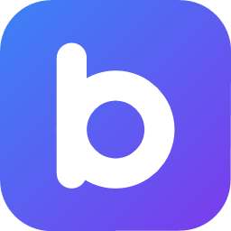

# Bare

A minimal, private web browser built on Chromium. Tabs, an address bar, and nothing else.

- **Chromium engine, bundled.** Bare ships its own copy of Chromium through the [Chromium Embedded Framework](https://github.com/chromiumembedded/cef) (CEF), so it doesn't depend on any browser engine installed on the computer.
- **Sandboxed.** Every web page runs in a locked-down Chromium sandbox process, the same model Chrome uses.
- **No bloat.** No accounts, sync, telemetry, news feed, shopping, AI assistant, translation, password manager or extension store.
- **Ad and tracker blocking built in**, using the same filter lists and rule syntax as uBlock Origin.
- **Signed automatic updates**, so security fixes reach users without them doing anything.
- **Private by default.** HTTPS-only, third-party cookies blocked, notifications denied.

## Download

Get the latest Windows build from [Releases](https://github.com/sai113/Bare/releases/latest): download `Bare-<version>-windows-x86_64.zip`, unzip it anywhere you can write to (e.g. your user folder, not Program Files, so it can update itself), and run `Bare.exe`. Windows SmartScreen may warn the first time because the app isn't code-signed: choose **More info → Run anyway**.

## Features

| | |
|---|---|
| Tabs | `Ctrl+T` new, `Ctrl+W` / `Ctrl+F4` close, `Ctrl+Tab` / `Ctrl+Shift+Tab` switch |
| Address bar | `Ctrl+L`, `Alt+D` or `F6`. Type a URL or search terms; `Esc` restores the current address |
| Navigation | `Alt+Left` / `Alt+Right`, `F5` or `Ctrl+R` to reload |
| Downloads | `Ctrl+J` or the ↓ button opens `bare://downloads`: progress, pause/resume, cancel, open, show in folder. The ↓ button shows live progress. Files go to your Downloads folder, or Bare can ask each time |
| Settings | The ⚙ button opens `bare://settings`: search engine, blocking, per-site exceptions, download location, clearing browsing data, updates |
| Blocker | The toolbar shows how many requests were blocked on the page. Click it to turn blocking off for a site that breaks (remembered; manage the list in Settings) |
| Secure DNS | Settings → Network: Automatic (default, like Chrome), Off, Cloudflare, Google, Quad9, AdGuard, Mullvad, NextDNS, CleanBrowsing, OpenDNS, or a custom DNS-over-HTTPS URL. Applies immediately |
| Proxy | Settings → Network: system settings (default), no proxy, manual (`http`, `https`, `socks4`, `socks5` + bypass list) or a PAC URL. Applies immediately |
| Find in page | `Ctrl+F`; `Enter` / `F3` next, `Shift+Enter` / `Shift+F3` previous, `Esc` to close |
| Site permissions | When a site asks for your camera, microphone, location, clipboard, … a bar under the address bar shows "*site* wants to …" with **Allow** / **Block**. Answers last until Bare closes. Notification requests are always refused |
| Page | `F12` dev tools; built-in PDF viewer |
| Private mode | `Bare.exe --private` (in-memory profile, nothing written to disk) |
| Open on start | `Bare.exe example.com`, `Bare.exe bare://settings` |

Search engines: DuckDuckGo (default), Brave Search, Startpage, Google, Bing.

## Ad and tracker blocking

Bare uses [adblock-rust](https://github.com/brave/adblock-rust), the engine inside the Brave browser, which understands the same filter syntax as uBlock Origin and Adblock Plus.

- **Network blocking:** every request a page makes (scripts, images, frames, workers, …) is checked against the filter lists, and matches are cancelled before any connection is made. Rules can target request types and first- vs third-party requests, so ads served from a site's own domain can be caught too.
- **Cosmetic filtering:** leftover ad boxes are hidden. Site-specific rules apply as the page loads; generic rules are matched against the class names and ids actually on the page, and kept up to date as it changes.

Lists, in `data/`, are loaded at startup and compiled once into a cache in the profile folder:

| List | Blocks | License |
|---|---|---|
| [EasyList](https://easylist.to) | Ads | GPLv3 / CC BY-SA 3.0 |
| [EasyPrivacy](https://easylist.to) | Trackers | GPLv3 / CC BY-SA 3.0 |
| [HaGeZi Multi PRO](https://github.com/hagezi/dns-blocklists) | Ads, trackers, device and app telemetry (TikTok, Yandex, Xiaomi, Huawei, …) | GPLv3 |
| [StevenBlack hosts](https://github.com/StevenBlack/hosts) | Ad, tracking and malware domains | MIT |
| Bare extra (`data/bare-extra.txt`) | Analytics and device telemetry the big lists miss (PostHog, LG/Roku TV, Windows settings telemetry, …) | MIT |

Optional, off by default (Settings → Ad and tracker blocking):

| Switch | Lists | Trade-off |
|---|---|---|
| **Block social media widgets** | [Fanboy's Social](https://easylist.to) (hides share buttons) + `data/bare-social.txt` (blocks Facebook, X, Pinterest, LinkedIn scripts and embeds on *other* sites) | "Log in with Facebook" and embedded posts on other sites stop working. The networks' own sites are unaffected |
| **Hide cookie banners** | [EasyList Cookie](https://easylist.to) | You don't see consent choices; sites usually fall back to necessary cookies only |

Switching these takes effect within a few seconds, without restarting.

Deliberately **not** blocked, because blocking them breaks things people use: YouTube video servers (`googlevideo.com`), YouTube watch-history pings, live-stream ad insertion (`dai.google.com`), newsletter links (`click.mailchimp.com`, `list-manage.com`), feature-flag services (LaunchDarkly) and Branch app links (`bnc.lt`).

Refresh the downloaded lists with `pwsh scripts/update-blocklist.ps1`. They ship with each release, so updates also refresh the lists. To see which hosts from a test site would get through, run the developer check in `src/block.rs` (`check_hosts`).

Not supported (yet): uBlock Origin's scriptlet injection, which some sites such as YouTube need for full ad blocking.

## Automatic updates

Each release publishes an archive plus a small manifest, `latest.txt`, containing the version, download URL and SHA-256 hash, **signed with an Ed25519 key that only the publisher holds**. Bare checks once a day (or on demand in Settings) and only installs an update if:

1. the signature verifies against the public key built into the app (`data/update-key.pub`),
2. the download is HTTPS and its SHA-256 matches the signed hash, and
3. the version is newer than the running one (blocks downgrade attacks).

The update is unpacked into a staging folder. When Bare closes (or you click **Restart to update**), a helper copies it over the app folder and, if requested, relaunches it. If Bare's folder isn't writable (for example in Program Files without admin rights), Settings says so and asks for a manual download.

### Publishing a release

Updates come from this repository's [GitHub Releases](https://github.com/sai113/Bare/releases). The addresses are set in `.cargo/config.toml`, so every build checks `https://github.com/sai113/Bare/releases/latest/download/latest.txt`.

The signing key was created once with `cargo xtask keygen`: the private half is `~/.bare/update-signing.key`, the public half is `data/update-key.pub` (committed, built into the app). **Back up the private key somewhere safe and never commit it.** Anyone with it can push code to every Bare user; if it's lost, existing installs can never be updated again.

For each release:

1. Bump `version` in `Cargo.toml` (e.g. `0.3.1`) and commit.
2. Run `cargo xtask release`. It builds, packages and signs `dist/Bare-<version>-windows-x86_64.zip` and `dist/latest.txt`.
3. On GitHub: **Releases → Draft a new release**, tag `v<version>` (e.g. `v0.3.1`), and attach **both** files. Publish it (not as a pre-release, so it counts as "latest").

Every installed copy of Bare then finds it within a day (or right away with Settings → Check now), verifies the signature and offers **Restart to update**. A new release must have a higher version than the installed one.

Update logs are written to `%LOCALAPPDATA%\Bare\update\update.log`.

## Security model

- **Chromium sandbox.** Renderer, GPU and utility processes run sandboxed. On Windows this uses CEF's `bootstrap.exe` launcher (shipped as `Bare.exe`), which loads `Bare.dll` inside the sandbox.
- **The UI is native, not a web page.** The tab strip and address bar are CEF Views widgets.
- **Built-in pages can't be abused by websites.** `bare://settings` and `bare://downloads` are generated by the browser and loaded as isolated `data:` documents. Their buttons send actions to a special `https://bare.invalid/<secret>/…` address that the browser intercepts and never actually loads. An action only runs if it carries the random per-session secret **and** comes from one of these pages. A site that somehow knew the secret still can't trigger anything; this is tested.
- **HTTPS-only.** `http://` navigations are upgraded to `https://`. Typing a full `http://` address allows that host for the session. `localhost` is always allowed.
- **The address bar never runs code.** `javascript:`, `file:` and `data:` input is treated as a search.
- **Popups open as tabs**, never as new windows.
- **Permission prompts are native.** The Allow/Block bar is part of the browser UI, so a page can't draw a fake one or click it. Chromium would normally save these answers forever; Bare resets them when it closes (and on the next start, if it crashed), so "Allow" never silently becomes permanent.
- **Downloads** get safe, unique file names (no path tricks, no overwriting); opening a downloaded program goes through Windows' normal SmartScreen checks.
- **Less phoning home.** Chromium background networking, component updates, domain reliability reporting, media-router (Cast) discovery, Translate and optimization hints are turned off. Extensions are disabled, so other software can't inject Chrome extensions.
- **Alloy runtime.** Bare uses CEF's lightweight Alloy mode rather than its Chrome mode, which leaves out Chrome's sign-in, sync and password services.

## Build

Requirements:
- [Rust](https://rustup.rs) (stable)
- CMake and Ninja (`winget install Kitware.CMake Ninja-build.Ninja` on Windows)
- Windows: the Visual Studio C++ build tools

```sh
cargo xtask package     # builds and assembles dist/Bare (about 440 MB)
dist/Bare/Bare.exe      # run it
cargo test -p bare --bin bare --no-default-features
```

The first build downloads CEF (about 170 MB) into `vendor/cef/`, which is not committed. For quick development on Windows without the sandbox, use `cargo run -p bare --bin bare --no-default-features`.

## Project layout

```
src/app.rs        process startup, Chromium settings and privacy defaults
src/ui.rs         window, tab strip, toolbar (CEF Views)
src/handlers.rs   per-page callbacks: HTTPS-only, blocking, popups, downloads, built-in page actions
src/block.rs      ad/tracker blocking (adblock-rust) and cosmetic filtering
src/pages.rs      bare://downloads and bare://settings
src/permissions.rs  site permission rules, wording, session-only grants
src/network.rs    secure DNS and proxy settings
src/downloads.rs  download tracking, safe file names, open / show in folder
src/settings.rs   user settings (settings.txt in the profile folder)
src/update.rs     signed auto-updates
src/url.rs        address-bar parsing, HTTPS-only rules
src/lib.rs        Windows sandbox entry point (RunWinMain)
src/main.rs       executable entry point (Linux, macOS, Windows without sandbox)
xtask/            cargo xtask package | keygen | release
assets/           app icon
data/             filter lists, update public key
scripts/          refresh filter lists, regenerate icon
```

## Platform status

| | Status |
|---|---|
| Windows x64 | Working and tested |
| Linux x64 | Code is cross-platform; not yet built or tested |
| macOS | Needs an `.app` bundle step and code signing; not yet done |

## Known limitations

- **Proxies that need a username and password** aren't supported yet (there's no sign-in prompt).
- **Secure DNS with a fixed provider** stops all browsing if your network blocks that provider (as Chrome does). Some networks block Cloudflare's and Quad9's; switch to another provider or Automatic.
- **Screen sharing** isn't supported yet (it needs a screen/window picker). Camera and microphone work.
- **Location** uses Windows' location service, so it only works if location is turned on in Windows Settings → Privacy & security → Location.
- Popups open without `window.opener`, so some "sign in with…" popup flows may not complete.
- No bookmarks or history UI yet.

## License

MIT. Chromium and CEF are distributed under their own licenses; their notices ship in `CREDITS.html` inside the packaged app. The filter lists keep their own licenses (see `data/LISTS.md`).
